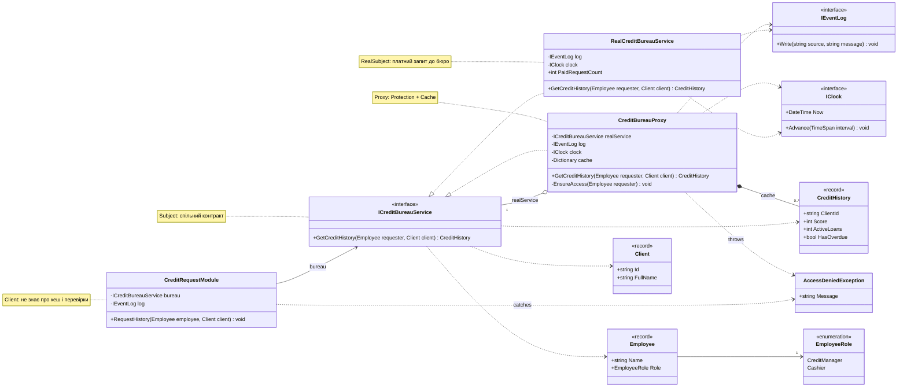

ЛАБОРАТОРНА РОБОТА №11
СТРУКТУРНІ ШАБЛОНИ ПРОЄКТУВАННЯ: ADAPTER,
DECORATOR, FACADE, PROXY

**Варіант 7**
**Предметна область:** БАНК «ПРУТ-КРЕДИТ»
### Розподіл завданнь

| Виконавиць           | Стек        | Завдання | Коротко про завдання                |
| -------------------- | ----------- | -------- | ----------------------------------- |
| Батрак Орина         | **C#**      | Task 1   | Звернення до бюро кредитних історій |
| Резніченко Анастасія | **Java**    | Task 2   | Опції банківської картки            |
| Резніченко Анастасія | **Java**    | Task 3   | Підключення системи SWIFT-платежів  |
| Батрак Орина         | **C#**      | Task 4   | Відкриття рахунку клієнту           |
| Кожен окремо         | **С#/Java** | Task 5   | Діаграми до завданнь                |
| Спільно              | С#/Java     | Task 6   | Рев'ю код                           |

## Завдання 1. Звернення до бюро кредитних історій

### Проблема

Для перевірки клієнта банк звертається до зовнішнього бюро кредитних історій. Кожен запит платний і виконується кілька секунд. У пілоті виявилось дві вади:

1. Кредитні менеджери запитували історію того самого клієнта кілька разів під час розгляду однієї заявки. Банк платив за кожен запит і щоразу чекав відповіді.
2. Доступ до кредитної історії мали навіть касири, хоча це конфіденційні дані.

Додаткова вимога: модуль кредитування не повинен знати ні про збереження результатів, ні про перевірки.

### Який шаблон і чому: Proxy

Ситуація описує **службові питання навколо дорогого об'єкта**: чи варто взагалі звертатися до нього, і чи має право цей користувач. Бізнес-поведінка бюро при цьому не змінюється, а інтерфейс залишається тим самим. За підказкою з лекції («інтерфейс той самий, але контролюється доступ») це **Proxy**. Він поєднує два види:

| Вид Proxy | Що робить у цьому завданні |
|---|---|
| Protection Proxy | перевіряє роль працівника; запит дозволено лише `CreditManager` |
| Cache Proxy | повертає збережену історію клієнта протягом робочого дня |

Чому не інші шаблони:

- **Decorator** додає нову поведінку й зазвичай збирається клієнтом як «матрьошка». Тут мета інша: контролювати доступ до об'єкта.
- **Adapter** змінює інтерфейс. Тут інтерфейс незмінний.
- **Facade** спрощує роботу з групою класів. Тут клас один.

### Як це реалізовано

- `ICreditBureauService` – спільний контракт (Subject). Його реалізують і справжній сервіс, і замісник.
- `RealCreditBureauService` – RealSubject. Виконує платний запит, збільшує лічильник `PaidRequestCount` і не знає про кеш та ролі.
- `CreditBureauProxy` – Proxy. Спочатку перевіряє роль (`EnsureAccess`), потім дивиться в кеш, і лише за його відсутності чи застарілості передає запит справжньому сервісу.
- `CreditRequestModule` – клієнт. Працює лише через `ICreditBureauService`, тому не знає, що перед ним замісник.

Порядок у проксі важливий: **спершу доступ, потім кеш**. Тоді касир не отримає чужу історію з кешу навіть тоді, коли вона там уже є.

Кеш прив'язаний до календарної дати (`DateOnly`) з `IClock`. Це реалізує «протягом робочого дня»: наступного дня запис вважається застарілим і виконується новий платний запит.

### Відповідність вимогам

| Вимога | Де виконується |
|---|---|
| Повторний запит протягом дня без звернення до бюро | `CreditBureauProxy`: кеш за `client.Id` і датою |
| Доступ лише для кредитних менеджерів, зрозуміла відмова | `EnsureAccess` кидає `AccessDeniedException("Недостатньо прав")` |
| Модуль кредитування не знає про кеш і перевірки | `CreditRequestModule` залежить лише від `ICreditBureauService` |

### Демонстраційний сценарій (`RunCreditBureauScenario`)

1. Кредитний менеджер запитує історію клієнта. Проксі пропускає запит, `RealCreditBureauService` робить платний запит до бюро.
2. Той самий менеджер запитує історію ще двічі. Проксі віддає результат з кешу, у журналі немає записів від `RealCreditBureauService`. Далі виводиться кількість платних запитів (1).
3. Касир намагається отримати історію. Проксі відмовляє, бюро не викликається.
4. Додатково: настає наступний робочий день, кеш застарів, виконується новий платний запит (лічильник 2).

### Діаграма класів

### Чого вдалося уникнути (за лекцією)

- **Identity Leak.** У `Program.cs` модуль кредитування отримує лише змінну типу `ICreditBureauService`, яка вказує на проксі. Прямий доступ до справжнього сервісу є лише в сценарії, і тільки для виведення лічильника.
- **Зайва складність.** Proxy тут виправданий: об'єкт дорогий (платний і повільний) і потребує захисту.

---
